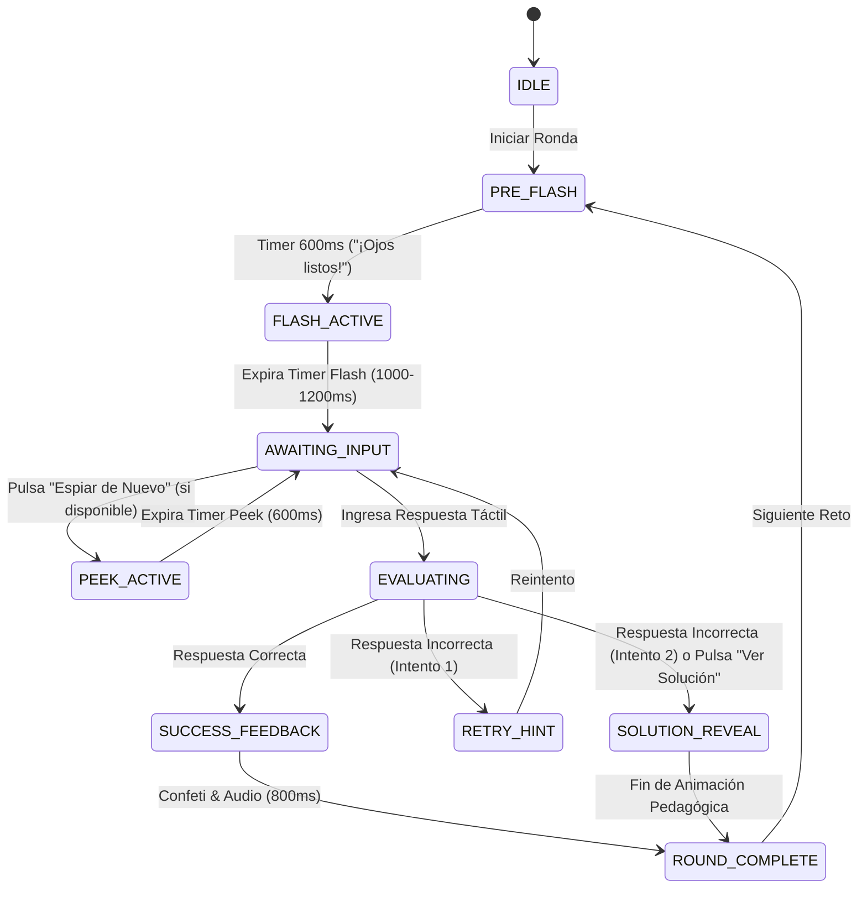

# Minijuego de Subitización Rápida con Marco de Diez (Ten-Frame)

* **Author:** juan8
* **Status:** Draft
* **Date:** 2026-11-11

--------------------------------------------------------------------------------

## Overview

Este documento de diseño define la arquitectura, experiencia de usuario y contratos técnicos para el primer minijuego de **MathKids Mobile**: el **Minijuego de Subitización Rápida con Marco de Diez**.

El objetivo central es desarrollar en niños de 5 a 10 años la **subitización conceptual** (reconocimiento visual instantáneo de cantidades numéricas sin recurrir al conteo unitario secuencial $1, 2, 3...$) mediante la estructura canónica del marco de diez ($2 \times 5$ horizontal, metodología Singapur). 

El sistema utiliza una mecánica de exposición ultracorta fija ("flash" de 1000 ms a 1200 ms en Nivel 1) tras la cual los objetos desaparecen pero el contorno de la grilla permanece como **anclaje espacial persistente**. La interacción táctil se desacopla enteramente de los teclados virtuales del sistema operativo mediante un teclado numérico táctil *in-app* con botones de $\ge 56 \times 56$ px, garantizando cero desplazamiento vertical de pantalla (*layout shift*) y respuesta sub-50 ms.

La progresión curricular escala desde la identificación unitaria en base 5 (1 a 10), pasando por la adición de dos dígitos mediante la estrategia de saturación a diez (**Make-10**) con doble grilla vertical, hasta la sustracción con mecánica de **desvanecimiento fantasma (Ghost Remnants)**.

--------------------------------------------------------------------------------

## The Problem

1. **Dependencia del Conteo Secuencial Unitario:** Los niños de 5 a 8 años tienden a contar objetos uno a uno con el dedo o de forma subvocal. Cuando se enfrentan a sumas o restas, esta estrategia satura su memoria de trabajo y retrasa el desarrollo del cálculo mental abstracto.
2. **Ansiedad por Temporizadores Continuos:** Los juegos educativos convencionales implementan barras de tiempo decrecientes que provocan angustia motriz y pulsaciones aleatorias sin procesar el estímulo matemático.
3. **Inestabilidad de Layout en Dispositivos Móviles:** En navegadores móviles (iOS Safari / Android Chrome), enfocar campos `<input>` activa el teclado virtual del sistema operativo, reduciendo el viewport entre un 40% y 50%, descolocando los marcos de diez y quebrando la inmersión lúdica infantil.
4. **Desconexión entre Geometría y Teclado:** Los teclados telefónicos numéricos estándar (disposición $3 \times 3$) no tienen relación espacial con las cantidades representadas en una grilla de diez casillas, perdiendo la oportunidad de reforzar el aprendizaje visoespacial.

--------------------------------------------------------------------------------

## Goals

* **[GOAL-01] Inhibición del Conteo Serial:** Exponer los elementos en la grilla durante una ventana fija de 1000 ms a 1200 ms (Nivel 1), tiempo insuficiente para el conteo serial pero óptimo para el registro de subitización en la memoria icónica.
* **[GOAL-02] Anclaje Espacial Inmutable:** Mantener los bordes y las 10 casillas vacías de la grilla $2 \times 5$ visibles en pantalla tras el flash, permitiendo al niño reconstruir la imagen mental y calcular espacios ocupados vs. vacíos ($10 - n$).
* **[GOAL-03] Estabilidad de Pantalla y Cero Layout Shift:** Implementar un teclado táctil virtual integrado en la aplicación (*in-app*), eliminando por completo cualquier invocación al teclado nativo del sistema operativo y manteniendo la pantalla fija en el viewport móvil (360px a 430px).
* **[GOAL-04] Isomorfismo Táctil-Visual en Nivel 1:** Disponer el teclado del Nivel 1 en una matriz exacta de $2 \times 5$ (1 a 5 arriba, 6 a 10 abajo), vinculando la memoria motriz de la mano con la posición espacial de las fichas.
* **[GOAL-05] Visualización Dinámica de Operaciones (Make-10 y Fantasma):** Representar sumas mediante trasvase animado de fichas entre dos marcos apilados para completar una decena, y restas mediante desvanecimiento a siluetas traslúcidas que conservan la relación visual $minuendo - sustraendo = diferencia$.
* **[GOAL-06] Tolerancia Cero a la Frustración:** Ofrecer una opción de rescate "Espiar de Nuevo" (1 uso por reto de 600 ms) y modo de explicación pedagógica ("Ver Solución") animada paso a paso.

--------------------------------------------------------------------------------

## Non-Goals

* **[NON-GOAL-01] Invocación de Teclados Nativos:** No se utilizarán elementos `<input>` editables que activen el teclado del sistema operativo.
* **[NON-GOAL-02] Interacción por Voz (ASR):** No se integrará reconocimiento de voz por micrófono debido a latencia, tasa de error y requerimientos de permisos.
* **[NON-GOAL-03] Persistencia en Base de Datos Externa:** No se gestionarán cuentas de usuario, autenticación ni almacenamiento en la nube; el estado de la sesión es en memoria conforme a `constitution.md`.
* **[NON-GOAL-04] Llenado Disperso o Aleatorio de Casillas:** No se generarán patrones no estructurados; el orden es estrictamente canónico (base 5 de izquierda a derecha).
* **[NON-GOAL-05] Descarga de Assets de Audio Pesados:** Cero archivos MP3/WAV externos; todos los efectos sonoros serán generados en tiempo real mediante Web Audio API sintetizada.

--------------------------------------------------------------------------------

## Open Questions

* **[Q-01] Curva Adaptativa del Flash:** ¿Debe el tiempo de exposición reducirse automáticamente a 800 ms si el niño alcanza una racha de más de 5 aciertos consecutivos, o debe permanecer estrictamente fijo según el selector de nivel manual?
* **[Q-02] Transición de Teclado en Nivel 2:** En niveles con respuestas superiores a 10 (ej. sumas hasta 20), el teclado pasa de la matriz $2 \times 5$ a un teclado numérico 0-9 con pantalla de confirmación. ¿Debe incluir un botón explícito "OK/Comprobar" o auto-evaluarse al ingresar el segundo dígito?

--------------------------------------------------------------------------------

## Critical User Journeys (CUJs)

### CUJ 1: Identificación Rápida en Nivel 1 (Subitización 1 a 10)
* **Given**: El niño selecciona el Nivel 1. La pantalla muestra un marco de diez horizontal vacío con bordes redondeados y un aviso visual lúdico ("¡Ojos listos!").
* **When**: Transcurren 600 ms de preparación y se disparan 7 manzanas en orden canónico (5 en fila superior, 2 en fila inferior izquierda) durante 1100 ms, tras lo cual las manzanas desaparecen dejando el marco vacío.
* **Then**: El teclado táctil $2 \times 5$ se habilita inmediatamente. El niño toca el botón "7" en la fila inferior. El sistema reproduce una tríada ascendente sintetizada con Web Audio API, lanza confeti ligero y suma +1 a la racha.

### CUJ 2: Adición Make-10 en Nivel 2 con Doble Grilla
* **Given**: El niño está en Nivel 2. La pantalla muestra dos marcos de diez apilados verticalmente: el superior con 8 fichas rojas y el inferior con 5 fichas amarillas ($8 + 5$).
* **When**: Concluye el tiempo de flash y las fichas desaparecen. El niño introduce "13" en el teclado táctil numérico y presiona comprobar.
* **Then**: El sistema valida la respuesta y activa la animación Make-10: 2 fichas del marco inferior viajan suavemente a llenar los dos huecos vacíos del marco superior completando 10, quedando 3 fichas abajo, mostrando la descomposición $10 + 3 = 13$.

### CUJ 3: Uso de Rescate "Espiar de Nuevo" (Anti-Frustración)
* **Given**: Durante el flash el niño se distrajo o parpadeó y no logró percibir la cantidad en el marco.
* **When**: El niño presiona el botón "Espiar de Nuevo" con icono de ojo antes de emitir respuesta.
* **Then**: El marco vuelve a encender los objetos durante un pulso rápido de 600 ms y el botón de rescate se deshabilita para el resto de la ronda, preservando la racha de aciertos.

### CUJ 4: Activación del Modo "Ver Solución"
* **Given**: El niño falla su respuesta o presiona directamente el botón "Ver Solución".
* **When**: Se inicia la secuencia de solución.
* **Then**: El marco vuelve a poblarse de manera permanente; la fila superior de 5 se ilumina con un halo dorado mientras suena una nota de 440 Hz con la etiqueta "+5", luego se iluminan las fichas restantes indicando el complemento, y se muestra un botón para avanzar al siguiente reto.

--------------------------------------------------------------------------------

## Technical Plan (Architecture)

### 1. Arquitectura de Componentes UI (React + Tailwind CSS)

Toda la vista del juego se renderiza dentro de un contenedor rígido vertical restringido a `100dvh` con `overscroll-behavior: none`, dividido en 4 zonas sin desplazamiento (*zero-scroll layout*):

```
┌────────────────────────────────────────────────────────┐
│ 1. Header & Racha (h: ~48px)                           │
│    [Nivel 1]   [🔥 Racha: 4]   [👁️ Espiar (1)]  [🔊]   │
├────────────────────────────────────────────────────────┤
│ 2. Escenario de Marcos de Diez (h: ~240px - 280px)     │
│    ┌───┬───┬───┬───┬───┐                               │
│    │ 🍎│ 🍎│ 🍎│ 🍎│ 🍎│  <- Marco A (Fila 1: Base 5)   │
│    ├───┼───┼───┼───┼───┤                               │
│    │ 🍎│ 🍎│   │   │   │  <- Marco A (Fila 2: Resto)    │
│    └───┴───┴───┴───┴───┘                               │
│    (Marco B apilado abajo solo en Niveles 2 y 3)       │
├────────────────────────────────────────────────────────┤
│ 3. Zona de Estado & Feedback (h: ~40px)                │
│    [ Indicador visual de exposición / "¡Ojos listos!" ] │
├────────────────────────────────────────────────────────┤
│ 4. Teclado Táctil In-App Ergonómico (h: ~180px - 220px)│
│    ┌───┐ ┌───┐ ┌───┐ ┌───┐ ┌───┐                       │
│    │ 1 │ │ 2 │ │ 3 │ │ 4 │ │ 5 │  (Isomórfico 2x5)    │
│    ├───┤ ├───┤ ├───┤ ├───┤ ├───┤                       │
│    │ 6 │ │ 7 │ │ 8 │ │ 9 │ │10 │  (56x56px min/botón) │
│    └───┘ └───┘ └───┘ └───┘ └───┘                       │
└────────────────────────────────────────────────────────┘
```

#### Árbol de Componentes
* `TenFrameGameView`: Componente raíz del minijuego que consume el hook `useTenFrameEngine`.
* `GameHeader`: Barra superior con selector de nivel, contador de racha, botón de audio y disparador del botón de rescate ("Espiar de Nuevo").
* `TenFrameStage`: Área contenedora de grillas (1 marco en Nivel 1; 2 marcos verticales en Niveles 2 y 3).
* `TenFrameGrid`: Renderizador puro de la matriz de $2 \times 5$ celdas con bordes definidos de 2px (`border-slate-300 dark:border-slate-600`), bordes externos redondeados y relación de aspecto proporcional.
* `TokenCell`: Celda individual de la grilla que gestiona sus estados visuales:
  * `empty`: Casilla vacía con fondo sutil (`bg-slate-50/50`).
  * `active`: Objeto renderizado (icono SVG de manzana o ficha circular coloreada).
  * `ghost`: Silueta traslúcida (`opacity-35`) con cruz fina de sustracción para el modo resta.
  * `base5-glow`: Destello dorado en los 5 elementos superiores durante la solución.
  * `transferring`: Clase CSS para animación de desplazamiento Make-10.
* `InAppKeypad`: Teclado numérico táctil desacoplado con dos variantes:
  * `IsomorphicKeypad` (Nivel 1): Matriz $2 \times 5$ de botones de $56 \times 56$ px, con respuesta táctil instantánea a un solo toque (*single tap auto-submit*).
  * `StandardNumericKeypad` (Niveles 2 y 3): Botones 0-9 con pantalla de previsualización y botón de borrado rápido para valores hasta 20.
* `SolutionReplayModal`: Capa de animación pedagógica guiada que se superpone para reproducir el razonamiento visual paso a paso.

---

### 2. Máquina de Estados Finita (FSM) del Motor de Juego

El ciclo de vida de cada reto se modela mediante una máquina de estados estricta gestionada en el hook `useTenFrameEngine`:



---

### 3. Contratos de Datos y Tipos TypeScript (`specs/contracts/ten-frame.types.ts`)

```typescript
export type TokenType = 'apple' | 'star' | 'circle' | 'heart';

export type KeypadMode = 'isomorphic-2x5' | 'numeric-standard';

export type GameOperationMode = 'single-count' | 'make-10-add' | 'ghost-subtract';

export interface TenFrameLevelConfig {
  levelId: 1 | 2 | 3;
  name: string;
  gridCount: 1 | 2;
  operationMode: GameOperationMode;
  keypadMode: KeypadMode;
  flashDurationMs: number;
  minTarget: number;
  maxTarget: number;
}

export interface TenFrameGridState {
  gridId: 'grid-a' | 'grid-b';
  filledCells: number; // 0 a 10
  tokenType: TokenType;
  tokenColor: string;
  ghostCells?: number; // Para modo resta
}

export interface RoundChallenge {
  id: string;
  level: 1 | 2 | 3;
  gridA: TenFrameGridState;
  gridB?: TenFrameGridState;
  expectedAnswer: number;
  mathematicalExpression: string; // Ej. "5 + 3 = 8" o "8 + 5 = 13"
}

export type FSMState =
  | 'IDLE'
  | 'PRE_FLASH'
  | 'FLASH_ACTIVE'
  | 'AWAITING_INPUT'
  | 'PEEK_ACTIVE'
  | 'EVALUATING'
  | 'SUCCESS_FEEDBACK'
  | 'RETRY_HINT'
  | 'SOLUTION_REVEAL'
  | 'ROUND_COMPLETE';

export interface TenFrameEngineState {
  fsm: FSMState;
  currentChallenge: RoundChallenge | null;
  selectedAnswer: number | null;
  attemptsLeft: number;
  peekUsedThisRound: boolean;
  streakCount: number;
  isAudioMuted: boolean;
}
```

---

### 4. Generador Matemático Procedural (`tenFrameGenerator.ts`)

Un motor puro determinista en memoria que asegura variedad y control pedagógico:
* **Nivel 1 (Subitización 1 a 10):** Genera cantidades aleatorias entre 1 y 10 evitando repetición consecutiva del mismo número. Prioriza patrones de $5 + n$ ($6, 7, 8, 9$).
* **Nivel 2 (Adición Make-10, Sumas hasta 20):** Genera sumandos $A \in [6, 9]$ y $B \in [2, 9]$ tales que la suma total sea $> 10$ para forzar la estrategia de rebase de decena ("completar 10").
* **Nivel 3 (Sustracción Fantasma):** Genera minuendo $M \in [5, 15]$ y sustraendo $S \in [1, M]$, garantizando que el resultado siempre sea $\ge 0$.

---

### 5. Motor de Síntesis de Sonido Nativo (`audioSynth.ts`)

Implementado con la Web Audio API nativa para cumplir el requisito de 0 KB en assets de audio:
* `playAttentionTone()`: Tono sinusoidal suave de 330 Hz (80 ms) que alerta visualmente sin sobresaltar.
* `playCorrectChime()`: Tríada arpegiada C5 (523 Hz), E5 (659 Hz), G5 (784 Hz) con decaimiento exponencial suave (400 ms).
* `playIncorrectTone()`: Tono triangular de baja frecuencia (180 Hz) filtrado con curva envolvente suave simulando un toque de madera amortiguado.
* `playTokenMoveTone(stepIndex)`: Frecuencias pentatónicas progresivas para acompañar cada ficha que se mueve durante la animación Make-10.

--------------------------------------------------------------------------------

## Alternatives Considered

### Alternative A: Temporizador Continuo con Barra Decreciente Visible
* **Pros**: Mecánica tradicional de videojuegos arcade que añade dinamismo y urgencia.
* **Cons**: Provoca angustia motora y pulsaciones a ciegas en niños de 4 a 7 años. No impide que el niño intente contar secuencialmente mientras el estímulo siga en pantalla.
* **Reason for Rejection**: `Rejected by author: Desencadena frustración y bloqueo cognitivo en lugar de favorecer la retención visual. La exposición flash con tiempo de respuesta libre aísla la memoria icónica sin estrés.`

### Alternative B: Teclado Numérico Nativo del Sistema Operativo (`<input type="number">`)
* **Pros**: Reduce la cantidad de componentes visuales propios de la app al delegar en el sistema.
* **Cons**: En iOS Safari y Android Chrome, el teclado virtual del sistema ocupa el 40-50% vertical de la pantalla, dispara saltos involuntarios de scroll y descoloca los marcos de 2x5.
* **Reason for Rejection**: `Rejected by author: Causa colapso severo del viewport móvil y rompe la inmersión visual. Se adopta un teclado táctil in-app integrado en el DOM.`

### Alternative C: Entrada por Voz mediante Reconocimiento de Voz (Web Speech API)
* **Pros**: Elimina la necesidad de interacción táctil al permitir que el niño "diga el número".
* **Cons**: Requiere permisos de micrófono, presenta alta latencia (>500 ms), alta tasa de fallos en acentos y dicción infantil, y depende de conectividad o soporte irregular de navegadores.
* **Reason for Rejection**: `Rejected by author: Falta de confiabilidad técnica en navegadores móviles, fricción de permisos de privacidad y latencia no apta para niños.`

### Alternative D: Sustracción mediante Superposición Directa de Grillas
* **Pros**: Planteamiento geométrico formal de comparación de áreas.
* **Cons**: Confunde a niños de 5 a 7 años sobre si las fichas se están agrupando o cancelando, y satura visualmente pantallas estrechas de 360px.
* **Reason for Rejection**: `Rejected by author: Carga cognitiva excesiva. Se adopta el Desvanecimiento Fantasma (Ghost Remnants) que preserva la noción intuitiva de "quitar" o remoción.`

### Alternative E: Ocultamiento Total de la Pantalla tras el Flash
* **Pros**: Evaluación estricta de memoria fotográfica sin estímulos residuales.
* **Cons**: Destruye la referencia geométrica espacial del marco de diez, impidiendo el razonamiento por complementos a 10 ($10 - \text{espacios vacíos}$).
* **Reason for Rejection**: `Rejected by author: Invalida el andamiaje pedagógico de Singapur. El contorno de la grilla 2x5 debe permanecer como anclaje espacial inmutable.`

--------------------------------------------------------------------------------

## Non-Functional Requirements

### Performance & Latency
* **Respuesta Táctil Sub-50 ms**: Todo toque en los botones del teclado in-app debe responder con retroalimentación visual inmediata (`active:scale-95`) sin latencia perceptible.
* **Animaciones Livianas a 60 FPS**: Transiciones puramente aceleradas por hardware (`transform`, `opacity`) que mantengan 60 FPS estables incluso en teléfonos inteligentes de gama baja.
* **Cero Descarga de Assets de Red**: Sin dependencias de red durante el juego; los sonidos se sintetizan en tiempo real y los iconos se renderizan mediante SVGs inline o emojis.

### Accessibility & Ergonomics
* **Hit Targets Ergonómicos Infantiles**: Botones de tamaño mínimo de $56 \times 56$ px con separación de al menos 12 px para evitar toques accidentales con dedos pequeños.
* **Contraste Accesible (WCAG AA)**: Razón de contraste mínima de 4.5:1 para bordes de celdas, tokens de color y números del teclado.
* **Tolerancia a la Frustración**: Prohibición de sonidos estridentes o penalizaciones punitivas ante respuestas incorrectas; refuerzo positivo y rescate ("Espiar de Nuevo").

--------------------------------------------------------------------------------

### Additional Resources

* Metodología de Singapur: Uso de Marcos de Diez (Ten-Frames) para la estructuración del sentido numérico.
* Clements, D. H., & Sarama, J. (2014). *Learning and teaching early math: The learning trajectories approach*.
* Lineamientos arquitectónicos de [`AGENTS.md`](file:///c:/Users/juan8/antigravity/JUEGOS%20MATEMATICOS/AGENTS.md) y [`constitution.md`](file:///c:/Users/juan8/antigravity/JUEGOS%20MATEMATICOS/specs/constitution.md).

### Future Improvements

* **Mastery Mode (Llenado por Pares):** Incorporar en fases futuras retos con distribución de fichas en pares verticales ($2, 4, 6...$) para profundizar la flexibilidad aritmética.
* **Modo Cooperativo / Tutor:** Opción para que un padre o docente configure los milisegundos del flash o active/desactive tipos de tokens.

--------------------------------------------------------------------------------

## Detailed Implementation Plan

### Target Files to Create/Modify

#### 1. `specs/contracts/ten-frame.types.ts` (Create)
* **Type / Scope**: Contrato de tipos TypeScript estricto.
* **Proposed Changes**: Define las interfaces `TenFrameLevelConfig`, `TenFrameGridState`, `RoundChallenge`, `FSMState` y `TenFrameEngineState`.
* **Rationale**: Asegura el desacoplamiento tipado entre el motor procedural, la FSM y los componentes visuales según la metodología SDD.

#### 2. `specs/minigames/marco-diez-subitizacion/spec.md` (Create)
* **Type / Scope**: Especificación formal de requisitos pedagógicos y funcionales en sintaxis EARS.
* **Proposed Changes**: Define requerimientos `[REQ-TF-001]` a `[REQ-TF-012]` (grilla 2x5, exposición flash por nivel, anclaje espacial, teclado in-app, Make-10 y desvanecimiento fantasma).
* **Rationale**: Documento fuente canónico exigido por `AGENTS.md` antes de implementar código productivo.

#### 3. `specs/minigames/marco-diez-subitizacion/plan.md` (Create)
* **Type / Scope**: Plan de tareas atómicas de implementación.
* **Proposed Changes**: Desglosa las fases: 1) Contratos, 2) Motor procedural, 3) Hook FSM, 4) Componentes UI, 5) Integración y pruebas.
* **Rationale**: Guía de ejecución atómica paso a paso para los agentes de desarrollo.

#### 4. `specs/minigames/marco-diez-subitizacion/validation.md` (Create)
* **Type / Scope**: Matriz de validación y escenarios BDD (Gherkin).
* **Proposed Changes**: Escenarios formales para verificación de no-regresión: subitización Nivel 1, traslado Make-10 Nivel 2, resta fantasma Nivel 3 y rescate "Espiar de Nuevo".
* **Rationale**: Contrato de aceptación BDD ejecutable con Vitest y React Testing Library.

#### 5. `specs/minigames/README.md` (Modify)
* **Type / Scope**: Documentación de catálogo de minijuegos.
* **Proposed Changes**: Registrar `MG-TF` ("Subitización Rápida con Marco de Diez") en la tabla de minijuegos como juego fundacional de 5 a 10 años.
* **Rationale**: Mantener sincronizado el catálogo del sistema.

#### 6. `specs/index.md` (Modify)
* **Type / Scope**: Índice maestro de arquitectura SDD.
* **Proposed Changes**: Añadir enlace al nuevo minijuego y sus artefactos (`spec.md`, `plan.md`, `validation.md`).
* **Rationale**: Trazabilidad documental centralizada del proyecto.

#### 7. `src/modules/minigames/ten-frame/types.ts` (Create)
* **Type / Scope**: Módulo de tipos locales del minijuego.
* **Proposed Changes**: Re-exporta y especializa los tipos de `specs/contracts/ten-frame.types.ts`.
* **Rationale**: Acceso directo para los componentes dentro de `src/modules/minigames/ten-frame/`.

#### 8. `src/modules/minigames/ten-frame/tenFrameGenerator.ts` (Create)
* **Type / Scope**: Motor matemático determinista procedural.
* **Proposed Changes**: Funciones puras `generateRound(level: 1 | 2 | 3, previousChallengeId?: string): RoundChallenge` y `calculateMake10Transfer(challenge: RoundChallenge)`.
* **Rationale**: Aísla la lógica matemática fuera de React para pruebas unitarias instantáneas con Vitest.

#### 9. `src/modules/minigames/ten-frame/audioSynth.ts` (Create)
* **Type / Scope**: Sintetizador procedural con Web Audio API nativo.
* **Proposed Changes**: Clase singleton `AudioSynth` con métodos `playAttentionTone()`, `playCorrectChime()`, `playIncorrectTone()` y `playTokenMoveTone(step)`.
* **Rationale**: Cumple el requisito de 0 KB en descarga de assets de audio conforme a `constitution.md`.

#### 10. `src/modules/minigames/ten-frame/useTenFrameEngine.ts` (Create)
* **Type / Scope**: Custom React Hook con Máquina de Estados Finita (FSM).
* **Proposed Changes**: Gestiona los 10 estados FSM, transiciones de timers con `performance.now()` y `cleanup` en `useEffect`, manejo del rescate "Espiar de Nuevo" y evaluación de respuestas.
* **Rationale**: Centraliza el ciclo de vida del juego y desacopla la lógica de renderizado.

#### 11. `src/modules/minigames/ten-frame/components/TokenCell.tsx` (Create)
* **Type / Scope**: Componente de celda individual de grilla.
* **Proposed Changes**: Renderiza estados visuales: vacío, activo (manzana/círculo), fantasma traslúcido y brillo base 5.
* **Rationale**: Unidad visual atómica con proporciones cuadradas y transiciones CSS aceleradas por GPU.

#### 12. `src/modules/minigames/ten-frame/components/TenFrameGrid.tsx` (Create)
* **Type / Scope**: Componente visual de grilla $2 \times 5$.
* **Proposed Changes**: Renderiza la matriz de $2 \times 5$ con bordes contrastados y asignación determinista de tokens en orden canónico.
* **Rationale**: Estructura geométrica central para la subitización en base 5.

#### 13. `src/modules/minigames/ten-frame/components/TenFrameStage.tsx` (Create)
* **Type / Scope**: Escenario de grillas para Nivel 1 (1 marco) o Niveles 2 y 3 (2 marcos apilados verticalmente).
* **Proposed Changes**: Contenedor con distribución vertical adaptativa según el número de marcos activos.
* **Rationale**: Soporta polimorfismo visual entre retos unitarios y operaciones aritméticas.

#### 14. `src/modules/minigames/ten-frame/components/InAppKeypad.tsx` (Create)
* **Type / Scope**: Teclado numérico táctil *in-app*.
* **Proposed Changes**: Renderiza `IsomorphicKeypad` (matriz $2 \times 5$ de 1 a 10) o `StandardNumericKeypad` (0 a 9) con botones $\ge 56 \times 56$ px y `touch-action: manipulation`.
* **Rationale**: Evita la apertura del teclado nativo del sistema operativo y asegura respuesta táctil sub-50 ms.

#### 15. `src/modules/minigames/ten-frame/components/SolutionReplayModal.tsx` (Create)
* **Type / Scope**: Componente de animación explicativa de la solución.
* **Proposed Changes**: Orquesta la revelación guiada paso a paso: iluminación dorada de la base 5, transferencias animadas Make-10 y desglose aritmético final.
* **Rationale**: Convierte el error en una oportunidad didáctica de aprendizaje sin frustración.

#### 16. `src/modules/minigames/ten-frame/TenFrameGameView.tsx` (Create)
* **Type / Scope**: Vista principal del minijuego.
* **Proposed Changes**: Integra Header, Escenario, Feedback y Teclado dentro del contenedor de 4 bandas `100dvh` con confetti canvas superpuesto.
* **Rationale**: Punto de entrada integrado del módulo para el shell de la aplicación.

#### 17. `tests/unit/minigames/ten-frame/tenFrameGenerator.test.ts` (Create)
* **Type / Scope**: Suite de pruebas unitarias con Vitest.
* **Proposed Changes**: Verifica que en 500 iteraciones aleatorias nunca se generen números fuera de rango, siempre se respete la base 5 canónica y nunca haya restas negativas.
* **Rationale**: Validación matemática rigurosa exigida por SDD.

#### 18. `tests/unit/minigames/ten-frame/useTenFrameEngine.test.ts` (Create)
* **Type / Scope**: Pruebas de integración de la FSM del hook con `@testing-library/react-hooks`.
* **Proposed Changes**: Comprueba las transiciones exactas de estados: expiración de flash, rescate por "Espiar", aciertos, fallos y reinicios.
* **Rationale**: Garantiza la estabilidad del ciclo de vida temporal de la sesión.

#### 19. `tests/integration/minigames/ten-frame/TenFrameGameView.test.tsx` (Create)
* **Type / Scope**: Pruebas de integración UI con React Testing Library.
* **Proposed Changes**: Verifica el flujo completo de usuario (CUJ 1 a CUJ 4) simulando interacciones táctiles y verificando ausencia de elementos `<input>`.
* **Rationale**: Garantiza que ningún elemento dispare el teclado virtual del navegador móvil.

---

### Verification Plan

* **Compilation/Build**:
  * Ejecutar `npm run build` o `npx tsc --noEmit` para asegurar cero errores de tipado estricto en TypeScript 5.x.
* **Unit Tests**:
  * Ejecutar `npx vitest run tests/unit/minigames/ten-frame/` para verificar al 100% el generador procedural y la FSM del hook.
* **Integration Tests**:
  * Ejecutar `npx vitest run tests/integration/minigames/ten-frame/` para validar el árbol de componentes y la respuesta táctil.
* **Static Analysis & Linting**:
  * Ejecutar `npm run lint` para garantizar cumplimiento de estándares de código limpio sin advertencias de dependencias en hooks.
* **Test Coverage Requirement**:
  * Cobertura de ramas $\ge 90\%$ en la lógica del generador matemático y del hook FSM.
* **Mobile Touch & Viewport Emulation**:
  * Verificar en emulador móvil (anchos de 360px a 430px en Chrome DevTools) que la pantalla no genere scroll vertical en ningún estado y que los botones táctiles mantengan $\ge 56 \times 56$ px.

--------------------------------------------------------------------------------

*Drafted with EGM*
